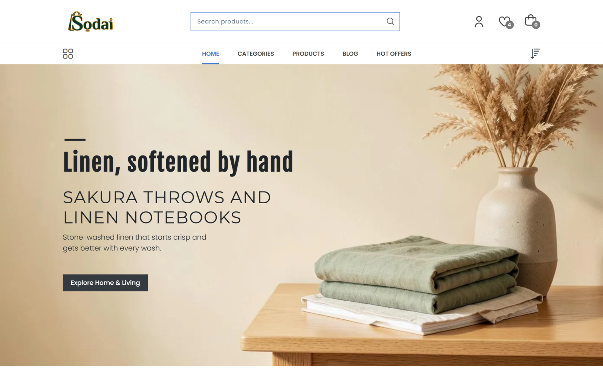
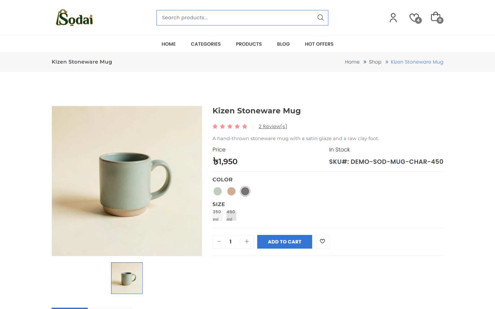
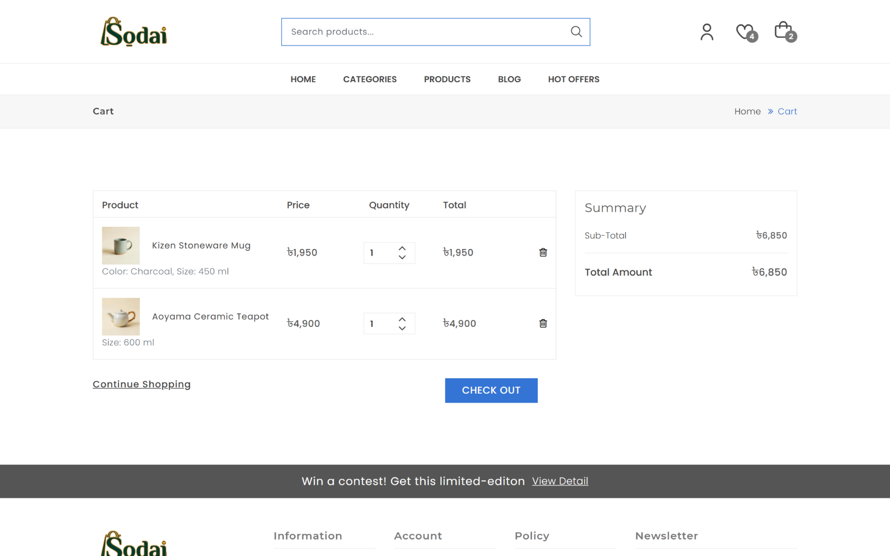
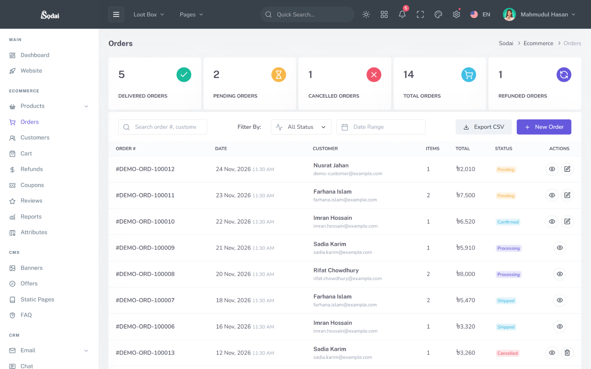
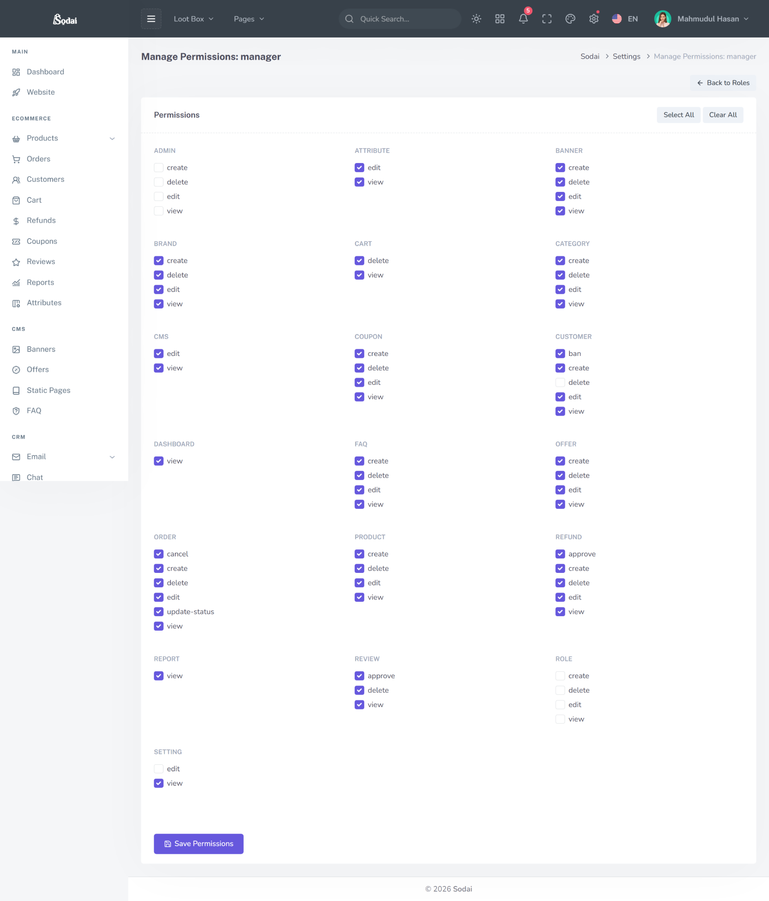

<p align="center">
  
</p>

<h1 align="center">Sodai</h1>

<p align="center">
  <strong>Open-source Laravel 13 e-commerce platform: a customer storefront and a
  permission-gated admin panel around a variant-based catalog, covered by 459 tests.</strong>
</p>

<p align="center">
  
  
  
  
  <a href="https://github.com/yenHunter/Sodai/actions/workflows/laravel.yml"></a>
  
</p>

<p align="center">
  <a href="#quick-start">Quick start</a> ·
  <a href="#screenshots">Screenshots</a> ·
  <a href="#highlights">Features</a> ·
  <a href="#tech-stack">Tech stack</a> ·
  <a href="#documentation">Documentation</a>
</p>

<p align="center">
  
</p>

**Live demo:** coming soon. Until it is hosted, the [quick start](#quick-start) below
brings the seeded demo catalog up locally in two commands.

> **License note:** Sodai's own code is MIT. The bundled **UBold** admin theme and
> **Ekka** storefront theme are commercially licensed on ThemeForest and are excluded
> from that grant — see [License](#license).

## What is Sodai?

Sodai is a single-vendor e-commerce platform split into two applications with their own
authentication guards: a Blade storefront for customers, and a separate admin panel behind
Spatie roles and granular permissions. It covers what a shop actually needs — scheduled
CMS banners and a filtered variant catalog, guest or registered COD checkout with real
stock locking, order tracking and cancellation, review moderation, refunds, CSV catalog
and order import/export, and a ten-group settings module.

It is a portfolio project rather than a hosted product: payment is Cash On Delivery only,
and the demo data is synthetic. The interesting part is the backend — a service layer that
writes orders inside a transaction, object-level authorization on every customer resource,
and a test suite that pins the business rules down. See
[`.github/project-instructions.md`](.github/project-instructions.md) for a continuously
updated breakdown of what is built versus planned.

## Quick start

Requirements: PHP 8.3+, Composer 2, Node 20+, and a database (SQLite by default).

```bash
git clone https://github.com/yenHunter/Sodai.git
cd Sodai
composer run setup          # install, .env, key, migrate, npm install, build assets
php artisan storage:link
php artisan demo:seed       # optional: the full demo catalog
composer run dev            # server + queue listener + logs + Vite
```

`composer run setup` expands to `composer install`, `.env` creation, `key:generate`,
`migrate --force`, `npm install`, and `npm run build`. The step-by-step equivalent:

```bash
composer install
cp .env.example .env
php artisan key:generate
npm install && npm run build
php artisan migrate --seed
```

After `php artisan demo:seed`, sign in as `demo-admin@example.com` / `Demo#12345`
(super admin) or `demo-customer@example.com` / `Demo#12345`. The normal development
accounts come from `database/seeders/AdminSeeder.php` and `CustomerSeeder.php` — change
them before any shared deployment.

### Demo catalog

`php artisan migrate --seed` installs only the normal development data. For a full
storefront — categories, brands, variant products with photos, banners, customers, orders
in every status, reviews, a coupon and a refund:

```bash
php artisan demo:seed        # or: php artisan db:seed --class=DemoCatalogSeeder
```

Set `SEED_DEMO_PASSWORD` to replace the demo password; outside local/testing the seeder
refuses to create accounts without it. `DEMO_DATE=2026-01-15` pins every relative date so
the history reproduces exactly for screenshots and tests.

Undo a demo run, and only that run, with `php artisan demo:clear` (`--dry-run` previews
it). Demo rows use their own identifiers (`DEMO-ORD-…` order numbers, `demo-…` slugs,
`DEMO-…` SKUs, `@example.com` accounts), and the command never deletes a real record: a
demo product still referenced by a real order, a demo coupon on a real order, or any
setting a shop has since changed is kept and reported. Settings the seeder created are
removed with it, and the demo photos copied into `storage/app/public` are cleaned up too.

## Screenshots

Every screenshot is captured from the seeded demo catalog.

| | |
|---|---|
|  |  |
| **Cart** | **Admin — order management** |
|  |  |
| **Admin — roles and permissions** | |
|  | |

## Highlights

**Storefront**
- Homepage driven by real data: scheduled CMS banners, featured/new/limited-time products,
  top categories
- Catalog with category/option/color/size/price filters and sorting; product pages with a
  variant matrix
- Guest or registered checkout, COD, with live shipping, tax and coupon validation
- Customer area: order history and timeline, cancellation, addresses, reviews, wishlist,
  profile and password

**Admin**
- Spatie RBAC with 5 seeded roles and granular permissions
- Variant-based product catalog (Color/Size/Weight/custom), generated SKUs, per-variant
  galleries, related products, tags, CSV import/export
- POS-style order builder, status-history audit trail, refund workflow, filtered CSV export
- Coupons, review moderation, abandoned-cart reminders, sales report emails, CMS banners,
  a ten-group cached settings module, and reCAPTCHA v3 plus rate limiting on every auth
  surface

**Engineering**
- Thin controllers with business logic in a dedicated service layer
- 459 tests / 1,899 assertions across 39 feature suites and 6 unit suites
- Form Request validation, soft deletes, security headers and CSP
- Whitelist HTML sanitizer for rich text, sanitized SVG uploads, object-level ownership
  checks on orders, reviews, addresses, cart and wishlist

<details>
<summary>Full feature list</summary>

**Storefront (Customer)**
- Homepage wired to real data: banners (scheduled CMS placements), featured/new/limited-time
  products, top categories
- Catalog with category/option/color/size/price filters and sorting, product detail pages
  with variant matrix
- Guest or registered checkout (guest checkout toggle in Settings), COD payment,
  live shipping charge/free-shipping threshold/tax and coupon validation via throttled AJAX
- Stock is re-locked and re-validated inside a DB transaction at order placement
- Customer account area: order history + timeline tracking, cancellation of pending orders,
  addresses (default management), reviews (only after delivered purchase), wishlist,
  profile/password management
- Email verification at registration; set-password bootstrap for admin-created customers
- CMS-backed policy pages (privacy, terms, shipping, return/refund) editable in admin
- Admin-brandable storefront: company name, logos (light/dark/favicon), SEO meta, and
  footer contact details all resolve from Settings → Branding with template defaults

**Admin Panel**
- Role-based access control (Spatie Permission) with 5 seeded roles and granular permissions
- Product catalog with **variant support** (Color/Size/Weight/custom options), auto-generated
  SKUs, image galleries scoped per-variant or shared, related products, tags
- Bulk product **CSV import/export**: re-importable catalog export (all products, or just the
  rows matching the current search/category/status filter), downloadable template, and an importer
  that matches variants by SKU and reports skipped rows with line numbers
- Category (2-level) and Brand management
- Order management with a POS-style builder: live AJAX shipping/tax/coupon calculation,
  editable overrides, full status-history audit trail, and a CSV export of the currently
  filtered order list (search, status, date range)
- Coupon engine (percentage/fixed, usage limits, validity windows)
- Refund workflow, independent from order cancellation, with approval/rejection
- Product review moderation with automatic rating recalculation
- Abandoned cart visibility + automatic reminder emails (30-minute scheduled job)
- Sales report emails: weekly (Mon–Sun) and monthly revenue summaries to the admin inbox
- CMS banners (position + scheduling based)
- A 10-group Settings module (company, design, shipping, payment, inventory, invoice,
  order rules, tax, notifications, marketing/SEO/social) — all backed by a generic,
  cached key-value `Setting` model
- reCAPTCHA v3 + rate limiting on all authentication surfaces (admin and customer)

**Engineering practices**
- Thin controllers, business logic in a dedicated Service layer
- 459 tests / 1,899 assertions across 39 feature suites and 6 unit suites, covering
  permissions, validation edge cases, and business rules (stock locking on order creation,
  coupon eligibility, refund balances, report window anchoring)
- Consistent Form Request validation, soft deletes on core models, security headers + CSP

**Security hardening**
- Whitelist-based HTML sanitizer on all unescaped rich-text rendering (CMS content,
  product descriptions) — strips scripts, event handlers, and dangerous URLs while
  preserving normal editor output
- Uploaded SVGs (design logos) are stored with active content stripped
- Rate limiting on every authentication surface plus checkout/coupon endpoints
  (coupon brute-force protection); throttled endpoints return 429
- Ownership enforcement on every customer resource (orders, reviews, addresses, cart,
  wishlist) via a dedicated trait — object-level authorization
- App-image-only `mimes`/`max` validation on all uploads; UUID filenames; no source-map
  files shipped to the browser; `composer audit` tracked clean

</details>

## Tech Stack

| Layer | Technology |
|---|---|
| Backend | Laravel 13.x, PHP 8.3 |
| Database | SQLite (dev), MySQL-ready |
| Authorization | Spatie Laravel Permission |
| Image processing | Intervention Image v4 (WebP conversion) |
| Frontend | Blade, Bootstrap 5.3 (UBold admin theme), Vite |
| Jobs / scheduling | Database queue, Laravel scheduler |
| Testing | PHPUnit 12, Playwright for browser flows |

## Testing

```bash
composer test                      # 459 tests, 1,899 assertions
php artisan test --filter=ProductModuleTest
```

Tests run against in-memory SQLite, so no database setup is needed. The feature suites
cover permissions and validation edges as well as business rules (stock locking, coupon
eligibility, refund balances, report window anchoring); the unit suites cover pure
services. Every pull request runs five GitHub Actions jobs: Pint style, asset build,
the PHP 8.3 test suite, a Playwright browser run, and a blocking `composer audit`.

## Project Structure Highlights

```
app/
├── Http/Controllers/Admin/     # Thin admin controllers
├── Http/Controllers/Visitor/   # Customer-facing controllers
├── Services/Admin/             # Admin business logic
├── Services/Visitor/           # Customer-facing business logic
├── Models/                     # Eloquent models (variant-based product graph)
routes/
├── admin.php                   # Prefixed /admin, permission-gated
├── visitor.php                 # Customer routes
├── web.php                     # Public + legacy template demo routes
tests/Feature/                  # Module-level test suites
```

## Documentation

- [`docs/queue-operations.md`](docs/queue-operations.md) — workers, retries, and the
  scheduled queue and failure alerts
- [`deploy/supervisor/sodai-queue-worker.conf`](deploy/supervisor/sodai-queue-worker.conf) —
  production queue worker program
- [`.github/project-instructions.md`](.github/project-instructions.md) — what is built
  versus planned, plus the full backlog
- [`CONTRIBUTING.md`](CONTRIBUTING.md) — branching strategy and coding standards
- [`THIRD-PARTY-NOTICES.md`](THIRD-PARTY-NOTICES.md) — bundled asset licenses

## Roadmap

See [`.github/project-instructions.md`](.github/project-instructions.md) for the full,
up-to-date backlog. Near-term priorities:

1. Payment gateway integration (COD is the only payment method today)
2. Admin dashboard KPIs (reports module is shipped, dashboard view is still placeholder)
3. Shipment update emails and broader queued customer notifications (guest order confirmation is shipped)
4. Storefront header polish: real category mega-menu, live search, wishlist count badge
5. 2FA for admin accounts

## Connect & Support

[](https://www.linkedin.com/in/firoz-ebna-jobaier)
[](buymeacoffee.com/yenHunter)
[](https://github.com/yenHunter)

## Contributing

This is currently a solo portfolio project, but the [contribution guide](CONTRIBUTING.md)
documents the branching strategy and coding standards used, in case that changes.

## License

Sodai's own source code — the application, routes, migrations, seeders, tests and
documentation — is released under the [MIT license](LICENSE).
Copyright (c) 2026 Firoz Ebna Jobaier. It is built on the
[Laravel framework](https://laravel.com), which is MIT-licensed as well.

The two UI templates bundled with the repository are **not** MIT and are excluded from
that grant:

- **UBold** — admin template by Coderthemes (admin panel)
- **Ekka** — storefront template by ashishmaraviya (customer storefront)

Both are commercially licensed on ThemeForest. They are committed so the application can
be run and reviewed, but reusing them requires your own license, or replacing them.
Composer and npm dependencies keep their own licenses. See
[THIRD-PARTY-NOTICES.md](THIRD-PARTY-NOTICES.md) for the full audit.
